<p align="center">
  
</p>

<p align="center">
  <a href="https://github.com/ishandutta2007/Awesome-Awesome-Awesome"></a><a href="https://discord.gg/jc4xtF58Ve"></a>
  <a href="https://github.com/ishandutta2007/Awesome-Enterprise-Mobile-SDK/stargazers"></a>
  <a href="https://github.com/ishandutta2007/Awesome-Enterprise-Mobile-SDK/network/members"></a>
  <a href="https://github.com/ishandutta2007/Awesome-Enterprise-Mobile-SDK/pulls"></a>
  <a href="https://github.com/ishandutta2007/Awesome-Enterprise-Mobile-SDK/blob/main/LICENSE"></a>
  <a href="https://github.com/ishandutta2007"></a>
</p>

---

# 📱 Awesome Enterprise Mobile SDK

> **A Curated Directory of Enterprise-Grade Mobile SDKs, Mobile Backend as a Service (MBaaS) Platforms, Cross-Platform Frameworks, and Offline-First Architectures.**

Welcome to the definitive developer reference and architectural catalog for **Enterprise Mobile SDKs**. Whether engineering mission-critical iOS/Android native applications, cross-platform apps with React Native or Flutter, or robust offline-first synchronization backends, this repository tracks production-grade platforms, verifiable starting tier pricing, transparent free tier quotas, and open-source ecosystems.

---

## 📑 Table of Contents

- [📈 Sector Overview & Market Dynamics](#-sector-overview--market-dynamics)
- [🏢 Enterprise SaaS Platforms & SDKs](#-enterprise-saas-platforms--sdks)
- [🌐 Open-Source Frameworks & Libraries](#-open-source-frameworks--libraries)
- [🏗️ Architectural Blueprint for Enterprise Mobile](#️-architectural-blueprint-for-enterprise-mobile)
- [🤝 How to Contribute](#-how-to-contribute)
- [💖 Support](#-support)
- [⭐ Star History](#--star-history)
- [⚖️ Compliance & Disclaimer](#️-compliance--disclaimer)

---

## 📈 Sector Overview & Market Dynamics

The global **Mobile Application Development Platform (MADP) & Enterprise Mobile SDK** market was valued at approximately **$17.5 billion in 2025** and is projected to expand beyond **$21 billion by 2026**, registering a compound annual growth rate (CAGR) exceeding 20.5% driven by AI agent mobile integration, enterprise field mobility, and hybrid cross-platform standardizations.

The sector demonstrates a **bifurcated market structure**:
- **Core Platform Concentration:** At the operating system and foundational cloud infrastructure tier, the market is **highly concentrated** around the Apple iOS / Google Android mobile operating system duopoly and cloud hyperscalers (Amazon Web Services, Microsoft Azure, Google Cloud).
- **Tooling & Service-Layer Fragmentation:** Conversely, at the enterprise SDK and middleware tier (MBaaS, real-time messaging, crash reporting, offline data sync, and identity), the market is **moderately-to-highly fragmented**. Rather than relying on a single monolithic vendor, enterprise engineering organizations assemble modular, best-of-breed SDK stacks combining hyperscaler backends with specialized communication and offline synchronization SDKs.

---

## 🏢 Enterprise SaaS Platforms & SDKs

The table below catalogs leading commercial SaaS mobile platforms and SDKs, **sorted descending by company size (valuation / market capitalization)**. All pricing tiers and free quota limits reflect specific entry-level thresholds.

| 🚀 Product & Mobile SDK | 🏢 Vendor / Parent Company | 📊 Company Size (Valuation / Revenue) | 💳 Starting Tier Pricing | 🎁 Free Tier & Trial Limits | 🛠️ Core Enterprise Capabilities |
| :--- | :--- | :--- | :--- | :--- | :--- |
| **[Firebase](https://firebase.google.com/)** | Alphabet Inc. (Google) | **$2.10 Trillion Market Cap**<br>*(FY24 Rev: $350B)* | **$0.06 / 100k reads** (Pay-as-you-go Blaze plan; $0.18/100k writes; $0.40/1M function calls) | **Free Forever (Spark Plan):** 1 GiB Cloud Firestore storage, 50k reads/day, 20k writes/day, 10 GB/month network egress, 10k phone auths/month, unlimited FCM push notifications, Remote Config, and Crashlytics | Cloud Firestore, Auth, FCM Push Notifications, Crashlytics, Remote Config |
| **[AWS Amplify](https://aws.amazon.com/amplify/)** | Amazon.com, Inc. (AWS) | **$2.05 Trillion Market Cap**<br>*(FY24 Rev: $620B)* | **$0.01 per build minute** + $0.15 per GB data served + $0.023/GB/month storage | **Free Forever & 12-Month Tier:** 1,000 build minutes/month, 15 GB served/month, 5 GB app storage/month; Amazon Cognito User Pools free forever up to 50,000 MAUs | Cognito Authentication, AppSync GraphQL offline sync, S3 Storage, Pinpoint Push |
| **[Salesforce Mobile SDK](https://developer.salesforce.com/docs/platform/mobile-sdk/overview)** | Salesforce, Inc. | **$280 Billion Market Cap**<br>*(FY25 Rev: $37.9B)* | **$25 / user / month** (Salesforce Starter Suite, billed annually; Enterprise at $165/user/month) | **Free Forever Developer Edition:** 2 full Salesforce CRM licenses, 5 MB data storage, 20 MB file storage, complete Mobile SDK & REST/GraphQL API access. Also offers 30-day enterprise free trial | Enterprise CRM integration, SmartStore encrypted offline caching, MobileSync, Agentforce AI |
| **[Twilio Voice & Video SDK](https://www.twilio.com/docs/voice/sdks)** | Twilio Inc. | **$12.5 Billion Market Cap**<br>*(FY24 Rev: $4.15B)* | **$0.0040 / min** for Mobile/WebRTC SDK-to-SDK audio ($0.0140/min outbound PSTN) | **Free Trial with $15.50 Credit** (no expiration date): Includes 1 free virtual telephone number and up to 1,000 trial SMS/calls to verified numbers | Programmable VoIP calling, custom ICE servers, call quality diagnostics, WebRTC media |
| **[Ionic Enterprise](https://ionic.io/enterprise)** | OutSystems / Ionic | **$4.3 Billion Valuation**<br>*(Rev: ~$300M+)* | **$499 / month** (Ionic Appflow Basic cloud builds; Enterprise Premier SLA starting at $1,500/month) | **Free Forever Community Tier** (CLI + OSS UI toolkit); **14-Day Free Trial** for Appflow Enterprise (100 cloud builds, 1 concurrent build, live deployments) | Secure biometric auth, offline SQLite storage engine, cloud CI/CD mobile builds |
| **[Sentry Mobile SDK](https://sentry.io/for/mobile/)** | Functional Software, Inc. | **$3.0 Billion Valuation**<br>*(ARR: ~$120M+)* | **$26 / month** (Team Plan billed annually, $29/mo monthly for 50k errors & 100k transactions) | **Free Forever (Developer Plan):** 5,000 error events/month, 10,000 performance transactions/month, 50 session replays/month, 1 GB file attachments, 1 seat | Real-time crash diagnostics, mobile session replays, ANR & app start profiling |
| **[Sendbird Mobile SDK](https://sendbird.com/)** | Sendbird, Inc. | **$1.05 Billion Valuation**<br>*(Series C Unicorn)* | **$399 / month** (Developer Starter Plan up to 5,000 MAUs; Business Plan at $599/month) | **Free Forever (Developer Plan):** Up to 100 MAUs, 5 peak concurrent connections, 10,000 messages/month, unlimited channels; plus **30-day enterprise trial** up to 1,000 MAUs | In-app chat, channel moderation, FCM/APNs push notifications, WebRTC audio/video |
| **[Supabase Mobile](https://supabase.com/)** | Supabase, Inc. | **$1.00 Billion Valuation**<br>*(Series B Unicorn)* | **$25 / month** (Pro Plan: 8 GB database space, 100 GB storage, 250,000 MAUs) | **Free Forever Plan:** 2 active projects, 500 MB Postgres database, 1 GB file storage, 50,000 MAUs, 500,000 Edge Function invocations/month | Postgres database, Row Level Security, Realtime subscriptions, Auth, Storage |
| **[Couchbase Capella & Mobile](https://www.couchbase.com/products/mobile/)** | Couchbase, Inc. | **$850 Million Market Cap**<br>*(FY24 Rev: $180M)* | **$0.27 / node / hour** (~$197 / node / month for single-node Basic Capella instance) | **30-Day Free Trial** (no credit card required): 1 hosted cluster, up to 3 nodes, 25 GB RAM/storage, and dedicated App Services mobile sync gateway endpoint | Embedded NoSQL Couchbase Lite, cloud sync gateway, peer-to-peer offline sync |
| **[OneSignal Mobile SDK](https://onesignal.com/)** | OneSignal, Inc. | **$800 Million Valuation**<br>*(Series C Funded)* | **$9 / month** base + $0.003 per subscriber / month (Growth Plan; Professional at $99/month) | **Free Forever Plan:** Up to 10,000 total subscribers, unlimited push notifications to mobile apps, 1 active in-app message carousel, 10 email sends/month | Push notifications (APNs/FCM), in-app messaging, automated drip journeys |

---

## 🌐 Open-Source Frameworks & Libraries

Curated repository catalog of open-source frameworks, client libraries, databases, and UI engines powering enterprise mobile development. **Sorted descending by GitHub stargazer count**.

1. **[Flutter](https://github.com/flutter/flutter)** [](https://github.com/flutter/flutter/stargazers)  
   *Google's UI toolkit (BSD-3-Clause) for building natively compiled cross-platform applications for mobile, web, and desktop from a single Dart codebase.*  
   `High-Performance Rendering` `Declarative UI` `Multi-Platform`

2. **[React Native](https://github.com/facebook/react-native)** [](https://github.com/facebook/react-native/stargazers)  
   *Meta's framework (MIT) for building native iOS and Android apps using React and JavaScript/TypeScript. Features the New Architecture with Fabric and TurboModules.*  
   `Fabric Renderer` `TurboModules` `Hermes Engine`

3. **[Ionic Framework](https://github.com/ionic-team/ionic-framework)** [](https://github.com/ionic-team/ionic-framework/stargazers)  
   *Cross-platform UI toolkit (MIT) for building native-quality iOS, Android, and Progressive Web Apps with standard Web Components, Angular, React, and Vue.*  
   `Web Components` `PWA & Hybrid` `UI Toolkit`

4. **[Expo](https://github.com/expo/expo)** [](https://github.com/expo/expo/stargazers)  
   *Universal React Native framework and development platform (MIT) with managed workflows, native module bridging, and EAS cloud build pipelines.*  
   `Universal Apps` `EAS Workflows` `Native Modules`

5. **[NativeScript](https://github.com/NativeScript/NativeScript)** [](https://github.com/NativeScript/NativeScript/stargazers)  
   *Empowers developers to build 100% native mobile apps (Apache-2.0) using JavaScript, TypeScript, Angular, or Vue without WebViews.*  
   `Direct Native APIs` `Zero WebView` `TypeScript`

6. **[.NET MAUI](https://github.com/dotnet/maui)** [](https://github.com/dotnet/maui/stargazers)  
   *Microsoft's .NET Multi-platform App UI (MIT) framework for creating native mobile and desktop applications with C# and XAML from a unified project system.*  
   `Enterprise .NET` `C# & XAML` `Cross-Platform`

7. **[Compose Multiplatform](https://github.com/JetBrains/compose-multiplatform)** [](https://github.com/JetBrains/compose-multiplatform/stargazers)  
   *JetBrains' declarative UI framework (Apache-2.0) based on Kotlin Multiplatform (KMP), enabling shared UI code across Android, iOS, desktop, and web.*  
   `Kotlin Multiplatform` `Jetpack Compose` `Native iOS Render`

8. **[PouchDB](https://github.com/pouchdb/pouchdb)** [](https://github.com/pouchdb/pouchdb/stargazers)  
   *Open-source in-browser and mobile database (Apache-2.0) designed to synchronize with CouchDB and remote databases, enabling robust offline-first functionality.*  
   `Offline-First` `CouchDB Protocol` `Bidirectional Sync`

9. **[Capacitor](https://github.com/ionic-team/capacitor)** [](https://github.com/ionic-team/capacitor/stargazers)  
   *Cross-platform native runtime (MIT) by Ionic that turns modern web apps into native iOS and Android apps with full access to device native APIs.*  
   `Cordova Successor` `Web Runtime` `Modern Native Plugins`

10. **[React Native Paper](https://github.com/callstack/react-native-paper)** [](https://github.com/callstack/react-native-paper/stargazers)  
    *High-quality, customizable Material Design component library (MIT) for React Native, supporting dark theme and accessible enterprise UX.*  
    `Material Design 3` `Theming` `Accessibility`

11. **[React Native Firebase](https://github.com/invertase/react-native-firebase)** [](https://github.com/invertase/react-native-firebase/stargazers)  
    *Battle-tested, modular React Native integration (Apache-2.0) for all Firebase services on iOS and Android with strict TypeScript typings.*  
    `Modular Architecture` `Push Notifications` `Analytics & Auth`

12. **[WatermelonDB](https://github.com/Nozbe/WatermelonDB)** [](https://github.com/Nozbe/WatermelonDB/stargazers)  
    *Reactive database framework (MIT) optimized for React Native and web applications, scaling smoothly to tens of thousands of records via lazy loading.*  
    `Reactive SQLite` `Extreme Scalability` `Offline Sync`

13. **[React Native Reanimated](https://github.com/software-mansion/react-native-reanimated)** [](https://github.com/software-mansion/react-native-reanimated/stargazers)  
    *Fluid animation and gesture-driven interaction library (MIT) executing directly on the UI thread for smooth 60/120 FPS enterprise mobile interactions.*  
    `UI Thread Worklets` `Fluid Micro-interactions` `Gestures`

14. **[AWS Amplify JS](https://github.com/aws-amplify/amplify-js)** [](https://github.com/aws-amplify/amplify-js/stargazers)  
    *Declarative JavaScript and TypeScript client library (Apache-2.0) for connecting mobile apps to AWS cloud services with offline synchronization.*  
    `AppSync GraphQL` `Cognito Auth` `S3 Storage`

15. **[SQLDelight](https://github.com/sqldelight/sqldelight)** [](https://github.com/sqldelight/sqldelight/stargazers)  
    *Generates typesafe Kotlin APIs from SQL statements (Apache-2.0), providing multiplatform database drivers for Android, iOS, JVM, and Web.*  
    `Kotlin Multiplatform` `Typesafe SQL` `Cross-Platform DB`

16. **[ObjectBox Java/Kotlin](https://github.com/objectbox/objectbox-java)** [](https://github.com/objectbox/objectbox-java/stargazers)  
    *Ultra-fast embedded NoSQL database (Apache-2.0) for Android and desktop with integrated real-time synchronization and minimal memory overhead.*  
    `NoSQL Embedded` `High Throughput` `Real-Time Observers`

17. **[Apollo Kotlin](https://github.com/apollographql/apollo-kotlin)** [](https://github.com/apollographql/apollo-kotlin/stargazers)  
    *Strongly-typed, caching GraphQL client (MIT) for Android and Kotlin Multiplatform, featuring normalized caching and reactive Query subscriptions.*  
    `GraphQL Client` `Normalized Cache` `Kotlin Coroutines`

18. **[Apache Cordova Android](https://github.com/apache/cordova-android)** [](https://github.com/apache/cordova-android/stargazers)  
    *Android application library (Apache-2.0) compiling standard HTML5, CSS3, and JavaScript code into native Android application packages.*  
    `Apache Foundation` `HTML5 Hybrid` `Plugin Ecosystem`

19. **[Firebase Android SDK](https://github.com/firebase/firebase-android-sdk)** [](https://github.com/firebase/firebase-android-sdk/stargazers)  
    *Open-source repository (Apache-2.0) containing the official Android client libraries for Google Cloud Firebase services.*  
    `Android Maven` `Firestore Client` `FCM Push`

20. **[Matrix Rust SDK](https://github.com/matrix-org/matrix-rust-sdk)** [](https://github.com/matrix-org/matrix-rust-sdk/stargazers)  
    *High-security, client-side implementation of the Matrix federated messaging protocol in Rust (Apache-2.0) with bindings for iOS and Android.*  
    `End-to-End Encryption` `Decentralized Messaging` `Rust Bindings`

21. **[Sentry React Native](https://github.com/getsentry/sentry-react-native)** [](https://github.com/getsentry/sentry-react-native/stargazers)  
    *Real-time crash monitoring, ANR detection, and distributed tracing SDK (MIT) for React Native mobile applications.*  
    `Crash Diagnostics` `Session Replay` `Performance Tracing`

22. **[Realm Kotlin](https://github.com/realm/realm-kotlin)** [](https://github.com/realm/realm-kotlin/stargazers)  
    *Mobile-first reactive database (Apache-2.0) for Kotlin Multiplatform and native Android, offering zero-copy object mapping and offline query speed.*  
    `Object Database` `Zero-Copy` `Reactive Coroutines`

23. **[OneSignal Android SDK](https://github.com/OneSignal/OneSignal-Android-SDK)** [](https://github.com/OneSignal/OneSignal-Android-SDK/stargazers)  
    *Native Android client SDK (MIT) for push notifications, in-app messaging cards, badge counts, and user tagging.*  
    `Push Notifications` `FCM Integration` `In-App Messages`

24. **[Salesforce Mobile SDK for iOS](https://github.com/forcedotcom/SalesforceMobileSDK-iOS)** [](https://github.com/forcedotcom/SalesforceMobileSDK-iOS/stargazers)  
    *Official open-source SDK (BSD-3-Clause) providing native Swift/Objective-C integration with Salesforce OAuth, SmartStore encrypted storage, and MobileSync.*  
    `Salesforce OAuth` `SmartStore Offline` `MobileSync REST`

25. **[Salesforce Mobile SDK for Android](https://github.com/forcedotcom/SalesforceMobileSDK-Android)** [](https://github.com/forcedotcom/SalesforceMobileSDK-Android/stargazers)  
    *Official open-source Android SDK (BSD-3-Clause) enabling native Kotlin/Java mobile enterprise integration with Salesforce data and security policies.*  
    `Android Keystore Security` `Offline Sync` `Salesforce APIs`

26. **[Twilio Voice React Native](https://github.com/twilio/twilio-voice-react-native)** [](https://github.com/twilio/twilio-voice-react-native/stargazers)  
    *Official React Native wrapper (Apache-2.0) for Twilio Programmable Voice SDKs, supporting Expo config plugins and React Native New Architecture.*  
    `VoIP Audio` `WebRTC` `Expo Compatible`

27. **[Agentforce Mobile SDK iOS](https://github.com/salesforce/AgentforceMobileSDK-iOS)** [](https://github.com/salesforce/AgentforceMobileSDK-iOS/stargazers)  
    *Salesforce SDK (BSD-3-Clause) for embedding autonomous generative AI agents into enterprise iOS applications with optional LiveKit voice.*  
    `Enterprise AI Agents` `Swift & SPM` `LiveKit Audio`

28. **[Sendbird Chat SDK Android](https://github.com/sendbird/sendbird-chat-sdk-android)** [](https://github.com/sendbird/sendbird-chat-sdk-android/stargazers)  
    *Native Android SDK (Apache-2.0) delivering scalable in-app chat, channel state synchronization, and background FCM push routing.*  
    `Real-Time Chat` `TLS 1.3 Security` `FCM Push Handling`

---

## 🏗️ Architectural Blueprint for Enterprise Mobile

When designing resilient, compliance-ready enterprise mobile applications, modern engineering architectures combine modular components across five functional layers:

```
┌─────────────────────────────────────────────────────────────┐
│                    📱 Presentation Layer                    │
│   React Native (Fabric)  │  Flutter (Impeller)  │  .NET MAUI│
└──────────────────────────────┬──────────────────────────────┘
                               │
┌──────────────────────────────▼──────────────────────────────┐
│                  🔄 State & Data Persistence                │
│   WatermelonDB  │  Couchbase Lite  │  Realm  │  SQLDelight  │
└──────────────────────────────┬──────────────────────────────┘
                               │
┌──────────────────────────────▼──────────────────────────────┐
│                 ☁️ Cloud MBaaS & Sync Gateway                │
│   Firebase (Firestore)  │  AWS Amplify  │  Supabase (PG)    │
└──────────────────────────────┬──────────────────────────────┘
                               │
┌──────────────────────────────▼──────────────────────────────┐
│               💬 Real-Time Communications & Comms           │
│   Twilio Voice (VoIP)  │  Sendbird (Chat)  │  OneSignal     │
└──────────────────────────────┬──────────────────────────────┘
                               │
┌──────────────────────────────▼──────────────────────────────┐
│               🛡️ Security, Identity & Diagnostics           │
│   Salesforce OAuth  │  Cognito  │  Sentry Crash Monitoring  │
└─────────────────────────────────────────────────────────────┘
```

- **Offline-First Sync:** Use embedded databases with delta synchronization (e.g., Couchbase Lite, WatermelonDB, Realm) so field workers remain productive without active network connectivity.
- **Enterprise Identity & Zero Trust:** Integrate standards-compliant OAuth2/OIDC (Cognito, Salesforce Mobile SDK, Supabase Auth) utilizing hardware-backed Keystores (Android Keystore / iOS Keychain).
- **Observability & Diagnostics:** Implement distributed tracing and error capture (Sentry) alongside APM metrics to monitor crash-free sessions and ANRs across device models.

---

## 🤝 How to Contribute

We welcome contributions from mobile developers, enterprise architects, and open-source maintainers!

1. 🍴 **Fork the Repository**
2. 🌿 **Create a Feature Branch** (`git checkout -b feat/add-awesome-sdk`)
3. 📝 **Add Your Entry:**
   - For **SaaS Platforms:** Maintain the table format with specific starting pricing and verified free tier limits.
   - For **Open-Source Projects:** Include the project description and ensure the repo includes the stargazers social badge:
     `[](https://github.com/<owner>/<repo>/stargazers)`
4. 🚀 **Submit a Pull Request** with a succinct description of the library's enterprise relevance.

---

## 💖 Support

A huge thank you to all the mobile engineers, open-source contributors, and enterprise architects exploring this repository! 🙌

If you find this ecosystem guide helpful, here is how you can support the project:
- ⭐ **Star this repository:** Show appreciation and increase visibility.
- 🍴 **Fork & Contribute:** Help keep pricing, quotas, and frameworks up to date.
- 📢 **Share:** Recommend it to your team, colleagues, and developer networks.
- ☕ **Buy Me a Coffee / Sponsor:** Support ongoing maintenance via the [GitHub Sponsor Dashboard](https://github.com/sponsors/ishandutta2007):

<p align="left">
  <a href="https://github.com/sponsors/ishandutta2007">
    
  </a>
  <a href="https://github.com/sponsors/ishandutta2007">
    
  </a>
</p>

---

##  Star History

[](https://star-history.dera.page/#ishandutta2007/Awesome-Enterprise-Mobile-SDK&type=date&legend=top-left)

---

## ⚖️ Compliance & Disclaimer

- **Community Curated:** This repository is maintained as an independent community reference and is not affiliated with or endorsed by Apple, Google, Salesforce, Amazon, or Meta.
- **Regulatory Compliance:** Enterprise mobile SDKs handling customer data must comply with international privacy standards, including GDPR, CCPA, and HIPAA, as well as official Apple App Store and Google Play Developer guidelines.
- **Lifecycle & Deprecations:** Always review vendor release roadmaps and deprecation policies (e.g., AWS Amplify v4 end-of-life) when architecting long-term enterprise software.

---

<p align="center">
  <b>⭐ Star this repository if it helps your enterprise mobile architectural decisions!</b>
</p>
